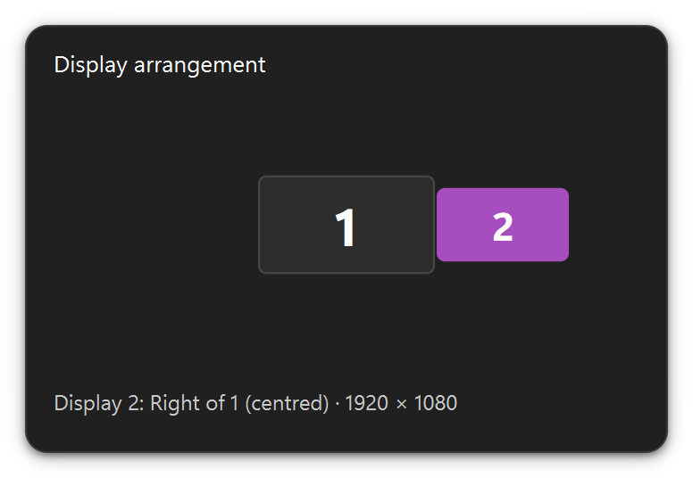
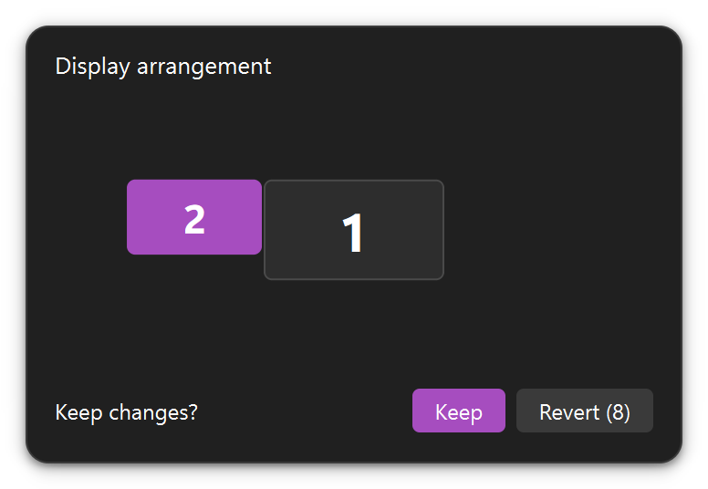
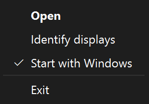

<p align="center">
  
</p>

<h1 align="center">Display Location</h1>

<p align="center">
  Move your second monitor to the left, right, top or bottom of your main one —<br>
  by dragging a tile in a small popup from the Windows tray.
</p>

<p align="center">
  <a href="https://github.com/soumyasubham-ssr/display-location/releases/latest"></a>
  
  
  
  <a href="LICENSE"></a>
</p>

<p align="center">
  <a href="https://github.com/soumyasubham-ssr/display-location/releases/latest/download/DisplayLocation.exe"><b>⬇ Download DisplayLocation.exe</b></a>
</p>

---

<p align="center">
  
  
</p>

## Why

Moving a second monitor from one side of your desk to another (laptop on the left today, on the right tomorrow) means opening **Settings → System → Display**, dragging the screen around, and clicking Apply. Display Location puts that one job in the tray: click, drag, done.

## Features

- **Drag to move.** Click the tray icon, drag tile **2** to any side of tile **1**. It snaps to the nearest edge (start, centre or end) and Windows applies it immediately.
- **Safe by default.** Every change shows **Keep / Revert** with a 10-second countdown. Do nothing and the old layout comes back — so a monitor that goes black can't strand you.
- **Live.** Plug a monitor in or out, switch Win+P to Duplicate, or change the layout in Settings: the popup follows within a quarter of a second.
- **Identify displays.** Shows a big **1** and **2** on the real monitors, so you know which is which.
- **Start with Windows** from the tray menu (respects Task Manager → Startup apps).
- **One small exe.** No installer, no admin rights, no settings file. Mixed scaling (e.g. 100 % + 125 %) handled correctly.

<p align="center">
  
  &nbsp;&nbsp;
  
</p>

## How it works

```text
 tray click ─► popup ─► drag tile 2 ─► snap to nearest side ─► Windows moves monitor 2
                                                                    │
                                     Keep ◄── 10 s countdown ◄──────┘ ──► Revert / timeout
```

1. **Read the layout.** The app asks Windows for every active display (`EnumDisplayDevices` / `EnumDisplaySettings`) and detects Duplicate mode with `QueryDisplayConfig`. Positions are in physical pixels, so mixed DPI doesn't distort anything.
2. **Draw it to scale.** The popup draws the main monitor as tile 1 and the other as tile 2, keeping their real proportions and relative position.
3. **Snap the drop.** When you let go, pure-Python maths picks the nearest side, keeps at least 10 % of the edges touching, and pulls the tile to start / centre / end when it's close.
4. **Apply.** One call to `ChangeDisplaySettingsEx` moves monitor 2 (the main monitor always stays at 0, 0). The app then reads the layout back and draws what Windows actually did.
5. **Keep or revert.** A 10-second countdown runs even if you close the popup. Revert, timeout, quitting the app or an unexpected error all put the previous position back.
6. **Stay in sync.** Qt's screen signals (added, removed, primary changed, geometry changed) trigger one debounced refresh — no polling.

More detail: [docs/ARCHITECTURE.md](docs/ARCHITECTURE.md).

## Install

1. [Download `DisplayLocation.exe`](https://github.com/soumyasubham-ssr/display-location/releases/latest) from the latest release.
2. Put it in a folder that won't move, **before** you turn on Start with Windows — for example:
   ```powershell
   New-Item -ItemType Directory -Force "$env:LOCALAPPDATA\Programs\DisplayLocation" | Out-Null
   Move-Item "$HOME\Downloads\DisplayLocation.exe" "$env:LOCALAPPDATA\Programs\DisplayLocation\"
   ```
   If you move it later, start it once from the new place: it updates the startup entry itself.
3. Double-click `DisplayLocation.exe`. The icon appears in the tray — look under the **^** arrow and drag it onto the taskbar to keep it visible.
4. Optional: right-click the icon → **Start with Windows**.

The exe isn't code-signed, so on first run SmartScreen may say *"Windows protected your PC"*: click **More info → Run anyway**.

**Uninstall:** untick Start with Windows, choose Exit from the tray menu, delete the folder.
**Log file:** `%LOCALAPPDATA%\DisplayLocation\logs\app.log`.

## Requirements and limits

- Windows 11 (Windows 10 should work but isn't tested), **exactly two monitors** in Extend mode. With one monitor, Duplicate mode, or three or more, the popup says so instead of showing tiles.
- Only monitor 2 moves; the app never changes which monitor is the main one, or any resolution.

Want separate taskbars per monitor, or monitor 2 to stay put when you switch virtual desktops? That's out of scope here — the [Windhawk](https://windhawk.net/mods) mods *Independent taskbar per monitor* and *Secondary Monitor Pin* do it well.

## Build from source

Python **3.14**, PySide6 and pywin32.

```powershell
py -3.14 -m venv "$env:LOCALAPPDATA\venvs\display-location"     # venv outside OneDrive / synced folders
& "$env:LOCALAPPDATA\venvs\display-location\Scripts\Activate.ps1"
pip install -e . -r requirements-dev.txt

python -m display_location               # run the tray app
python -m pytest                         # 166 tests, none change your real layout
.\build.ps1                              # build dist\DisplayLocation.exe (one file, ~49 MB)
```

Developer extras: `python -m display_location --list` prints the displays; `--side left|right|top|bottom` moves monitor 2 straight away (**no** revert). `python tools/make_screenshots.py` regenerates the images in this README.

`build.ps1` needs the venv active; PyInstaller's work folders go to `%LOCALAPPDATA%\DisplayLocation\build-tmp` and only `dist\DisplayLocation.exe` is written to the project.

## Project docs

The project is planned and built from Markdown docs that double as shared memory between AI-assisted work sessions.

| File | What |
|---|---|
| [REQUIREMENTS.md](docs/REQUIREMENTS.md) | What the app must do (FR / NFR) |
| [ARCHITECTURE.md](docs/ARCHITECTURE.md) | How it is built |
| [DECISIONS.md](docs/DECISIONS.md) | Why — decision log D-001 … D-015 |
| [ROADMAP.md](docs/ROADMAP.md) | Milestones and task status |
| [tasks/](docs/tasks/) | One file per task, with completion notes |
| [CHANGELOG.md](docs/CHANGELOG.md) | What changed, newest first |
| [AI_WORKFLOW.md](docs/AI_WORKFLOW.md) | Role-based AI workflow settings |

## License

[MIT](LICENSE) © 2026 Soumya Subham Rout
